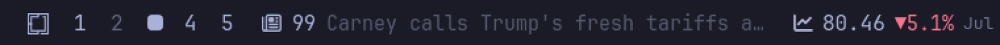
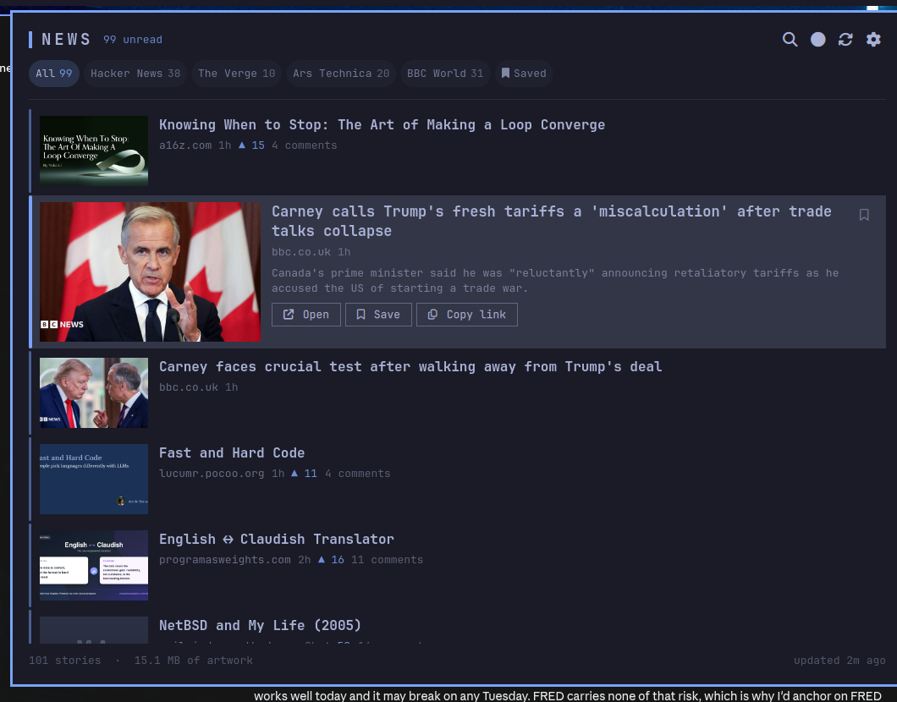
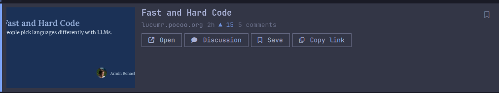
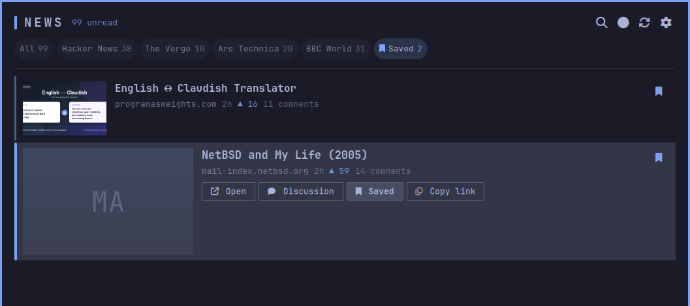
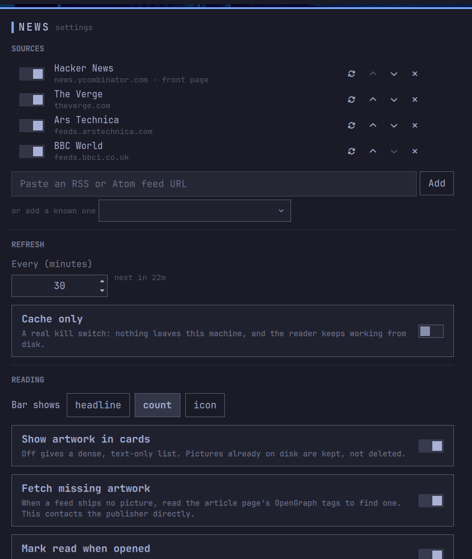
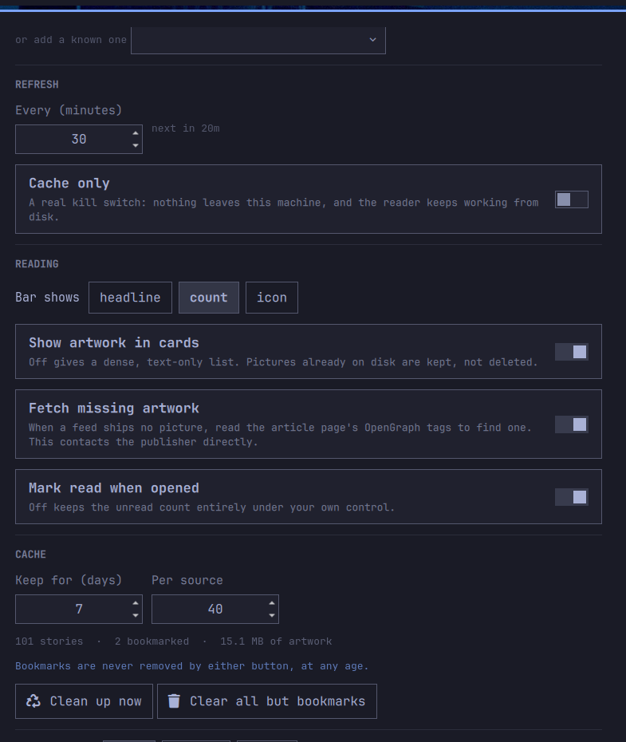

<h1 align="center">News</h1>

<p align="center">
  A news reader that lives in the <a href="https://omarchy.org">Omarchy</a> bar.<br>
  Hacker News out of the box, any RSS or Atom feed you paste in, article artwork,
  bookmarks nothing can delete, and a cache you control.
</p>

<p align="center">
  
</p>

<p align="center">
  
</p>

---

## Install

A plugin is just a git repo with a `manifest.json` at its root, so Omarchy can
install it directly:

```bash
omarchy plugin add https://github.com/alejandro-llanes/omarchy-news.git
```

That clones it into `~/.config/omarchy/plugins/io.github.alejandro-llanes.news/` and asks
whether to enable it and where to put it. To skip the prompts:

```bash
omarchy plugin add https://github.com/alejandro-llanes/omarchy-news.git --enable --yes
```

> [!NOTE]
> Plugins run as unsandboxed code inside your long-lived `omarchy-shell`
> process. Omarchy warns you before cloning and lands plugins disabled so you
> can read the code first. That is good advice for this plugin too — read
> `Service.qml` and `bin/news-media`, they are the two files that touch the
> network.

Keeping it current, and removing it:

```bash
omarchy plugin update io.github.alejandro-llanes.news   # shows a diff, then fast-forwards
omarchy plugin remove io.github.alejandro-llanes.news
```

### By hand

```bash
git clone https://github.com/alejandro-llanes/omarchy-news.git \
  ~/.config/omarchy/plugins/io.github.alejandro-llanes.news
omarchy-shell shell rescanPlugins
omarchy plugin enable io.github.alejandro-llanes.news
```

### Requirements

Omarchy 4.x (the Quickshell-based `omarchy-shell`). Everything it leans on is
already on an Omarchy box: `bash`, `curl`, `file`, `sha1sum`, and
`omarchy-launch-browser`. No packages to install, no API key to obtain, no
account anywhere.

## Use

Left-click the bar widget to open the reader. Right-click for sources and
settings. Middle-click to refresh now. Scroll the widget to flip through
headlines without opening anything.

<p align="center">
  
</p>

The focused card expands in place — larger picture, the standfirst, and buttons
for every action. The list never jumps under the cursor, and the keyboard and
the mouse drive exactly the same thing.

| Key | Does |
|-----|------|
| `j` `k`, `↓` `↑` | move between stories |
| `enter`, `o` | open in your browser |
| `c` | open the discussion (HN thread, or the feed's comments link) |
| `b`, `s` | bookmark |
| `y` | copy the link |
| `u` | unread only |
| `/` | filter headlines |
| `tab` | next source |
| `shift+A` | mark the current source read |
| `g` `G` | first / last story |
| `r` | refresh now |
| `,` | sources and settings |
| `esc` | clear the filter, or close |

Mouse: click a card to focus it, click again (or double-click) to open,
middle-click to bookmark, right-click for the discussion. Right-clicking a
source chip refetches just that source — handy when its dot has gone red.

### Bookmarks

Press `b` on anything worth keeping. The **Saved** chip collects them.

<p align="center">
  
</p>

A bookmark is permanent: no retention window, no per-source cap, and no source
removal deletes one, at any age. That is the single rule the cache code is
written around, and the test suite pins it from several directions — including
a 400-day-old bookmark surviving a 7-day retention sweep, and a bookmark far
past a per-source cap surviving that cap.

## Sources

Hacker News is the only source out of the box, read through HN's own search
backend so the front page arrives complete with points and comment counts in a
**single** request, where the Firebase API would need thirty.

Paste any RSS or Atom feed URL into the settings menu to add your own, or take
one of the known-good presets in the same place (Lobsters, Ars Technica, The
Verge, BBC World, Show HN, Ask HN).

<p align="center">
  
</p>

Feeds are parsed by a tolerant scanner rather than a strict XML parser. Real
feeds carry stray ampersands, undeclared namespaces and mismatched tags
constantly, and a reader that goes blank because one item had a bad entity is
worse than one that shows 29 of 30 stories.

## Artwork

Pictures come from whatever the feed actually provides — `media:content`,
`media:thumbnail`, `enclosure`, `itunes:image`, or an `` inside the
summary. That last one matters more than it sounds: The Verge declares no media
element at all and buries its lead image in a CDATA summary.

When the feed provides nothing, the article page's OpenGraph tags are read for a
lead image.

Everything found is downloaded to disk first, and **cards only ever render
files from that local cache** — the reader never points an image at a
publisher's URL. Two reasons. A remote image loaded by the shell would sit
outside the download limits, with nothing checking that what came back is even
an image; and it would tell the publisher the moment you laid eyes on the
headline. A story whose picture has not been fetched yet shows its plate until
it has.

Stories that genuinely have no picture anywhere — plain-text blogs, most of the
better ones — get a plate generated from the publisher's domain instead of a
hole in the layout. Same domain, same plate, every time, in whatever theme is
loaded.

Feeds that carry video (a YouTube channel feed, a podcast with video enclosures)
show the poster frame with a play badge and open in your browser, which is where
the codecs and the logins already are.

"Fetch missing artwork" governs the second step only — reading article pages
for a picture the feed left out. Turn it off and the reader still caches the
images feeds name themselves, but contacts no server the feed did not already
point at. "Cache only" stops everything.

Turn artwork display off and you get a dense, text-only list — pictures already
on disk are kept, not deleted.

## Settings

Everything is in the right-click menu, and everything is written to this
widget's entry in `~/.config/omarchy/shell.json`. There is no second config file
to drift out of sync with the bar.

| Setting | Default | Notes |
|---------|---------|-------|
| Refresh every | 30 min | Every source on the same tick, spaced apart |
| Keep unread for | 7 days | Bookmarks ignore this |
| Stories per source | 40 | Bookmarks sit outside the cap |
| Fetch missing artwork | on | Reads article pages for a picture the feed omitted. Off still caches images the feed names itself |
| Show artwork in cards | on | Off gives a dense text list |
| Cache only | off | A real kill switch: nothing leaves the machine |
| Bar shows | headline | `headline` rotates unread, or `count`, or `icon` |
| Headline rotates every | 12 s | Headline mode only |
| Mark read when opened | on | Off leaves the unread count entirely to you |

## The cache

```
~/.local/state/omarchy-news/
  cache.json      stories, read state, bookmarks   (0600)
  artwork/        downloaded pictures              (0700)
```

The directory is `0700` and the cache `0600`, because what you read is nobody
else's business.

<p align="center">
  
</p>

Two buttons in the settings menu, both of which spare bookmarks:

- **Clean up now** — applies the retention window and the per-source cap, then
  deletes artwork that no surviving story points at.
- **Clear all but bookmarks** — drops every unbookmarked story and its pictures.
  Two-step, because it is not reversible.

The same cleanup runs automatically after each refresh, so the cache stays
bounded on its own. The settings menu shows the current size next to the
buttons.

## Keybinding it

The reader answers to shell IPC, so any Hyprland binding can open it:

```lua
-- ~/.config/hypr/bindings.lua
o.bind("SUPER SHIFT", "N", "omarchy-shell io.github.alejandro-llanes.news panel")
```

The full surface:

```bash
omarchy-shell io.github.alejandro-llanes.news panel        # open/close the reader
omarchy-shell io.github.alejandro-llanes.news config       # open/close the settings menu
omarchy-shell io.github.alejandro-llanes.news bookmarks    # open the reader on saved stories
omarchy-shell io.github.alejandro-llanes.news refresh      # fetch now
omarchy-shell io.github.alejandro-llanes.news cleanup      # apply retention + cap now
omarchy-shell io.github.alejandro-llanes.news clear        # drop everything except bookmarks
omarchy-shell io.github.alejandro-llanes.news markAllRead
omarchy-shell io.github.alejandro-llanes.news status       # JSON: counts, cache size, last refresh
```

## How it is put together

```
Service.qml        headless singleton: fetching, scheduling, cache, bookmarks
BarWidget.qml      the bar pill; a pure view, it never fetches
Panel.qml          the reader
ConfigMenu.qml     sources and settings
components/        MediaFrame, NewsCard, SourceChip
lib/               Feed, Media, Store, Sources, Format  (pure JS, unit-tested)
bin/news-media     bounded curl for OpenGraph scraping and artwork download
```

One service instance owns every request. The bar widget is instantiated once per
monitor, so a widget that fetched for itself would poll every publisher once per
screen.

Article pages are read by `bin/news-media` rather than in QML, because pages are
routinely 400–500 KB and that much markup does not belong in the shell's JS
heap. Every fetch there is bounded in time and in bytes; artwork is identified
by sniffing the downloaded bytes rather than trusting the URL, so an HTML error
page never lands in the picture cache; and the delete path refuses any path that
does not resolve inside the cache directory.

Only `http` and `https` URLs are ever accepted, at parse time — a feed cannot
talk this plugin into handing a `file:` or `javascript:` URL to a browser launch
or an image loader.

A feed response is refused once it passes 4 MB, checked against the declared
`Content-Length`, again while the body is still arriving, and once more before
parsing. The shell is a single long-lived process that also draws the desktop,
so a server answering a feed request with something enormous is a problem to
bound rather than to buffer.

Every piece of feed-supplied text is stripped of markup before display, and
every `Text` in the plugin asks for `PlainText` explicitly. Both, not either:
markup that is double-escaped in the feed reappears when the entities are
decoded, and a `Text` left on Qt's default `AutoText` would render the result —
including any `` it contains, which is a read receipt sent to whoever
wrote the feed.

## Tests

```bash
node test/run.mjs
```

119 assertions, no dependencies, no network. Every fixture in `test/fixtures/`
is a real response captured from the feed it is named after, so the parser is
tested against markup that actually shipped:

- an Atom feed whose lead image is an `` buried in a CDATA summary
- a feed whose only picture is a 240 px thumbnail worth upgrading
- a YouTube feed whose `media:content` is a Flash-era stub that must **not** be
  treated as playable
- link-only feeds with no artwork at all
- tracking parameters that would otherwise fork one story into many
- a JS array crossing a QML `var` boundary, where `Array.isArray()` answers
  false and once silently discarded every configured feed

## Licence

MIT. See [LICENSE](LICENSE).
